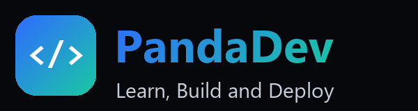
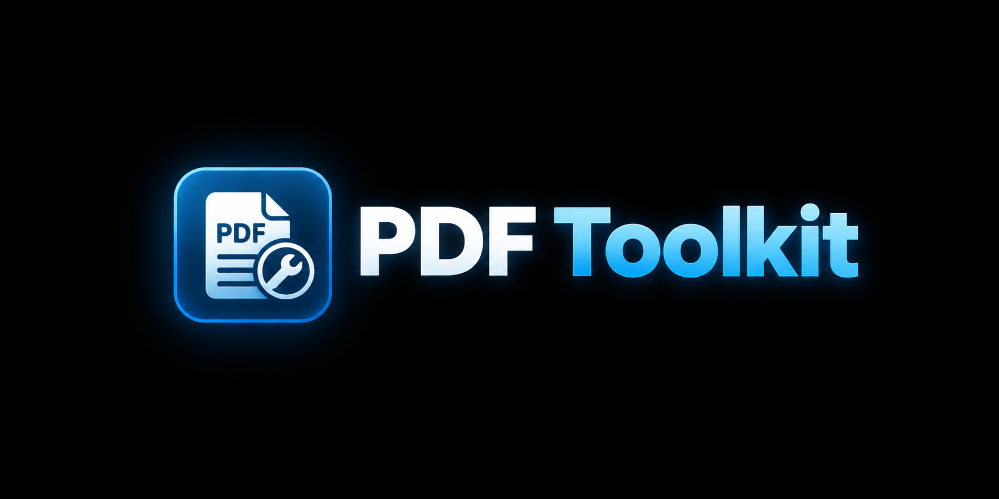
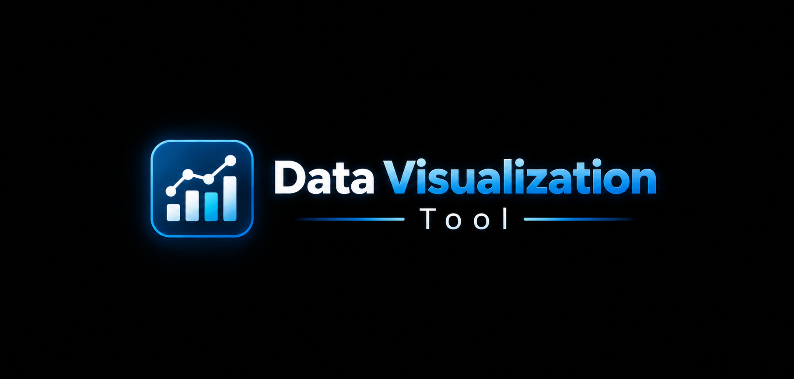
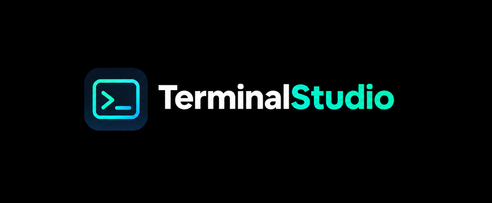

**CUSTOM WEB APPLICATIONS & SOFTWARE DEVELOPMENT**

<h2 align="center">PandaDev <code>// Development Studio</code></h2>

**Highlights**
- Custom web and mobile applications, business dashboards, client portals, automation and websites.
- End-to-end client workflow: project requests, digital contracts, secure document signing, Stripe payments and project workspaces.
- App Catalogue with application demos, downloads and project showcases.
- Client support tickets, milestones, invoices, call booking, site monitoring and monthly reports.
- Free learning hub with guided projects, code challenges, a playground and 25 browser-based developer tools.
- Team and freelancer management with role-based permissions, audit logs and mandatory staff 2FA.
- 12 languages with Hebrew and Arabic RTL support, dark/light themes and installable PWA.
- [Explore PandaDev services and applications](https://www.pandadevhub.com/).

**Tech Stack**

| Layer | Technology |
|:--|:--|
| Backend | Python · Flask 3 · SQLAlchemy 2 · Flask-Migrate |
| Frontend | Jinja2 · Tailwind CSS · HTML · JavaScript · Material Icons |
| Database | PostgreSQL (production) · SQLite (development) |
| Security | Flask-Login · Flask-WTF · Flask-Limiter · TOTP 2FA |
| Documents | fpdf2 · qrcode · Pillow |
| Integrations | Stripe · Resend · Authlib |
| Deployment | Render · Gunicorn · Docker · PWA |

---

<h2 align="center">Featured Applications</h2>

<!-- Two-column GitHub-compatible application showcase. -->
<table>
<tbody>
<tr>
<td align="center" width="50%" valign="top"></td>
<td align="center" width="50%" valign="top"></td>
</tr>
<tr>
<td align="center" valign="top"></td>
<td align="center" valign="top"></td>
</tr>
<tr>
<td align="center" valign="top"><strong>VulnHawk</strong> Web security scanning, repository audits &amp; monitoring <a href="https://vulnhawk.app">Launch VulnHawk ↗</a></td>
<td align="center" valign="top"><strong>GameHubJS</strong> Free browser games &amp; community features <a href="https://www.gamehubjs.com/">Play GameHubJS ↗</a></td>
</tr>
<tr>
<td valign="top"><strong>Highlights &amp; Tech Stack</strong>  • 83 security checks; OWASP Top 10:2025 • GitHub audits, scan comparisons &amp; compliance mapping • Seven report formats, scheduled scans &amp; SSL/uptime alerts • MFA, PWA &amp; worker monitoring  <strong>Stack:</strong> Python, FastAPI, SQLAlchemy, PostgreSQL, SQLite, Jinja2, Tailwind, APScheduler, Stripe, Resend, Render</td>
<td valign="top"><strong>Highlights &amp; Tech Stack</strong>  • 60+ browser games with leaderboards &amp; achievements • Google OAuth, 2FA, chat &amp; tournaments • Favorites, administration &amp; donations • Six languages, RTL &amp; PWA  <strong>Stack:</strong> Python, Flask, Jinja2, SQLAlchemy, PostgreSQL, SQLite, SocketIO, Redis, Canvas, Three.js, Stripe, Resend</td>
</tr>
</tbody>
</table>

---

<h2 align="center">Featured Tools</h2>

<!-- Three-column GitHub-compatible tools showcase. -->
<table>
<tbody>
<tr>
<td align="center" width="33%" valign="top"></td>
<td align="center" width="33%" valign="top"></td>
<td align="center" width="33%" valign="top"></td>
</tr>
<tr>
<td align="center" valign="top"><strong>PDF Toolkit</strong> 14 browser-based PDF tools <a href="https://pdf-toolkit-1cwa.onrender.com/">Launch PDF Toolkit ↗</a></td>
<td align="center" valign="top"><strong>Data Visualization Tool</strong> Spreadsheet charts &amp; reports <a href="https://data-visualization-tool-j92b.onrender.com/">Launch Data Visualization Tool ↗</a></td>
<td align="center" valign="top"><strong>SchemaCraft</strong> Visual database schema designer <a href="https://schemacraft-pandadev.onrender.com">Launch SchemaCraft ↗</a></td>
</tr>
<tr>
<td valign="top"><strong>Highlights &amp; Tech Stack</strong>  • Merge, split, convert &amp; compress PDFs • Visual comparison &amp; result previews • Local processing; English &amp; Spanish  <strong>Stack:</strong> React, Vite, JavaScript, CSS, pdf-lib, PDF.js, fflate</td>
<td valign="top"><strong>Highlights &amp; Tech Stack</strong>  • Import CSV, TSV &amp; Excel files • Seven charts, filters &amp; data-quality insights • Local processing; dashboard exports  <strong>Stack:</strong> React, Vite, Recharts, Papa Parse, SheetJS, Web Workers, jsPDF</td>
<td valign="top"><strong>Highlights &amp; Tech Stack</strong>  • Design tables, relationships &amp; indexes • PostgreSQL, MySQL &amp; SQLite SQL exports • Version comparison, migrations &amp; local backups  <strong>Stack:</strong> JavaScript, HTML, CSS, SVG, Web Workers, Python, uv</td>
</tr>
<tr>
<td align="center" width="33%" valign="top"></td>
<td align="center" width="33%" valign="top"></td>
<td align="center" width="33%" valign="top"></td>
</tr>
<tr>
<td align="center" valign="top"><strong>Terminal Studio</strong> Interactive Linux terminal learning <a href="https://terminalstudio-pandadev.onrender.com">Launch Terminal Studio ↗</a></td>
<td align="center" valign="top"><strong>Dev Tools</strong> 63 browser-based developer utilities <a href="https://devtools-pandadev.onrender.com">Launch Dev Tools ↗</a></td>
<td align="center" valign="top"><strong>Python Academy</strong> Interactive Python learning platform <a href="https://python-academy-pandadev.onrender.com">Launch Python Academy ↗</a></td>
</tr>
<tr>
<td valign="top"><strong>Highlights &amp; Tech Stack</strong>  • 40+ simulated commands &amp; virtual files • Guided lessons, challenges &amp; command previews • Tabs, checkpoints, offline workspace  <strong>Stack:</strong> JavaScript, HTML, CSS, ES modules, Python, uv</td>
<td valign="top"><strong>Highlights &amp; Tech Stack</strong>  • JSON, YAML, regex, encoding &amp; security tools • Local editors, diffs &amp; tool chaining • 11 categories; private, offline-capable  <strong>Stack:</strong> JavaScript, HTML, CSS, CodeMirror, Web Workers, Python, uv</td>
<td valign="top"><strong>Highlights &amp; Tech Stack</strong>  • 200 lessons &amp; 400 knowledge checks • 210 practice variants &amp; 15 projects • Persistent IDE with browser-based Python  <strong>Stack:</strong> JavaScript, HTML, CSS, Pyodide, Web Workers, Python, uv</td>
</tr>
</tbody>
</table>

---

<h2 align="center">⚡ Toolbox <code>// Stack</code></h2>

<h3 align="center">💻 Languages</h3>

       

    

<h3 align="center">🎨 Frontend & Development Tools</h3>

       

       

<h3 align="center">🗄️ Backend & Databases</h3>

       

       

<h3 align="center">☁️ Cloud, Mobile & Infrastructure</h3>

       

       

<h3 align="center">🤖 AI, Data & Other Tools</h3>

       

    

---

<h2 align="center">📈 GitHub <code>// Activity & Consistency</code></h2>

  

 

  

