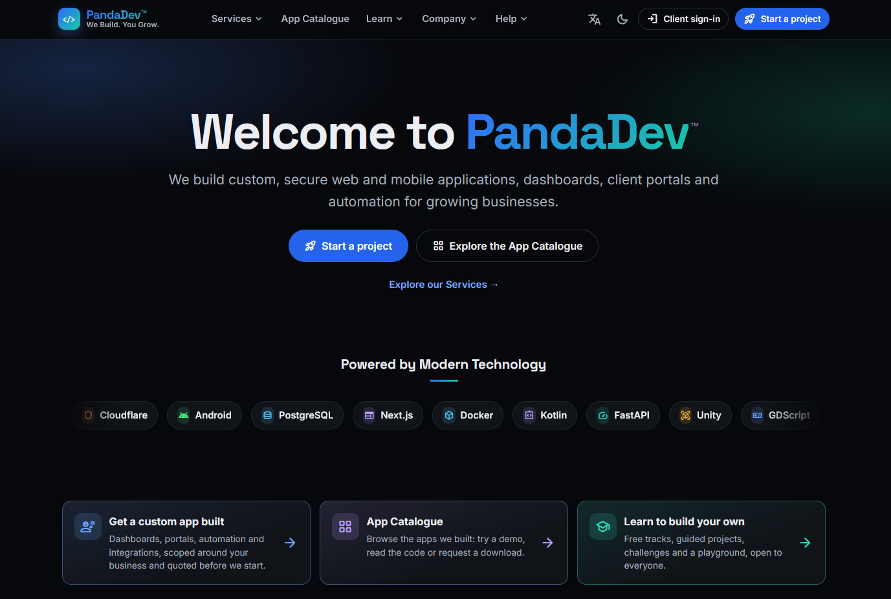
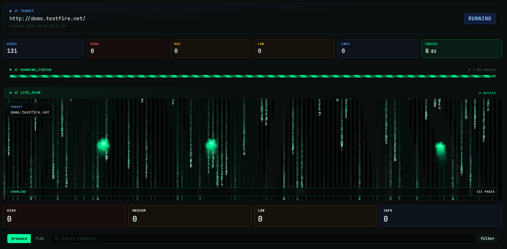
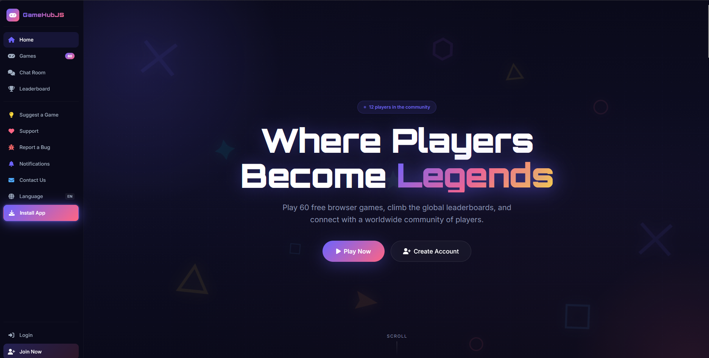
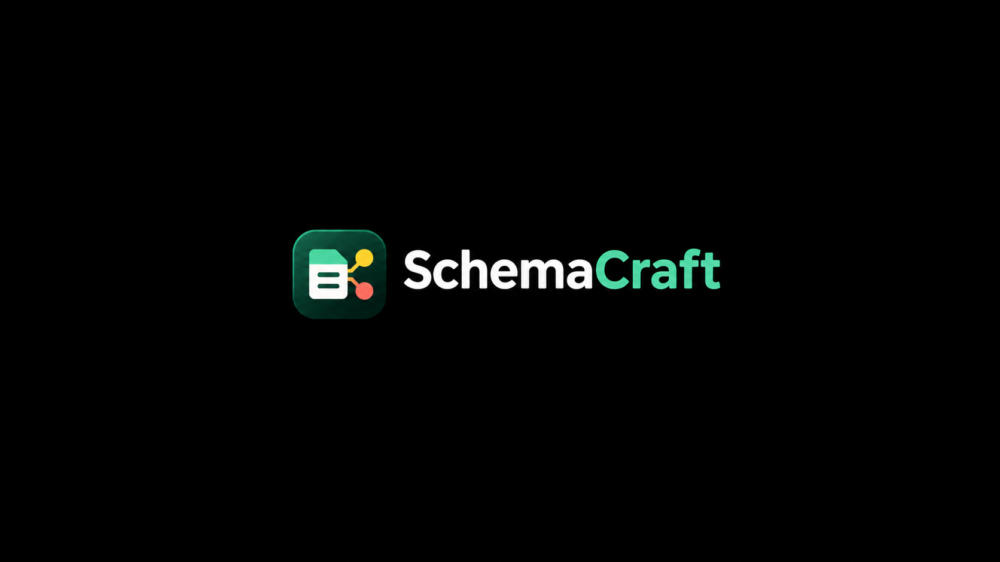
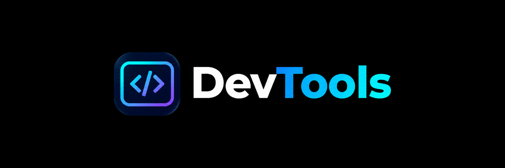
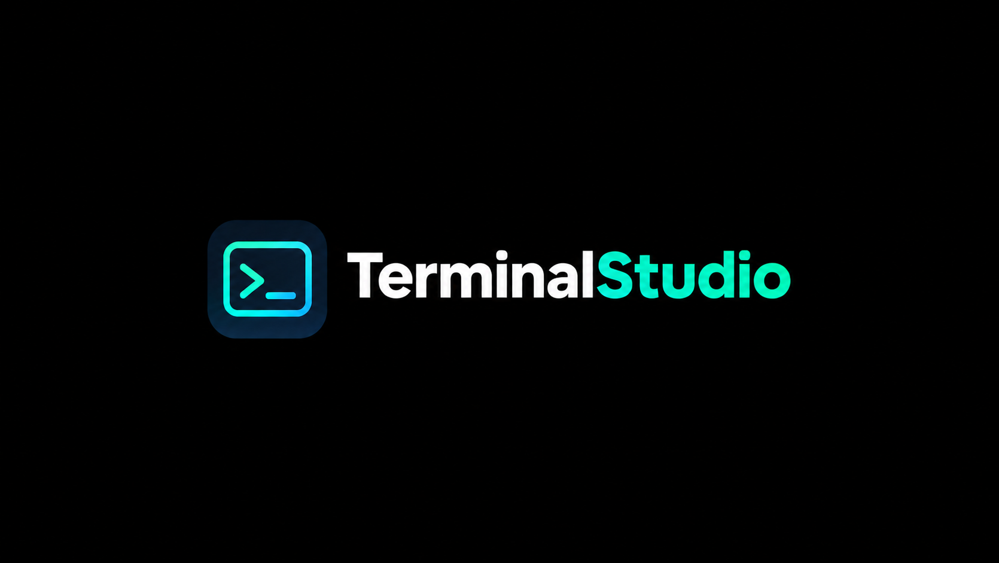
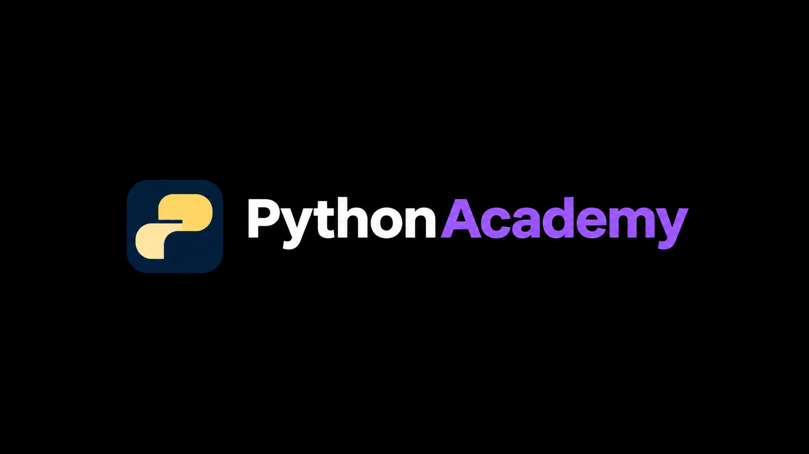
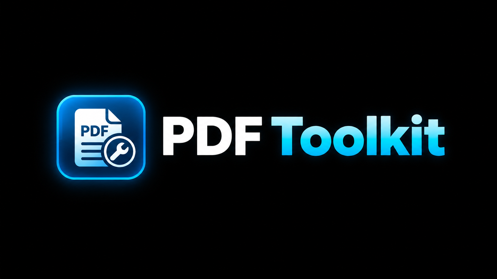
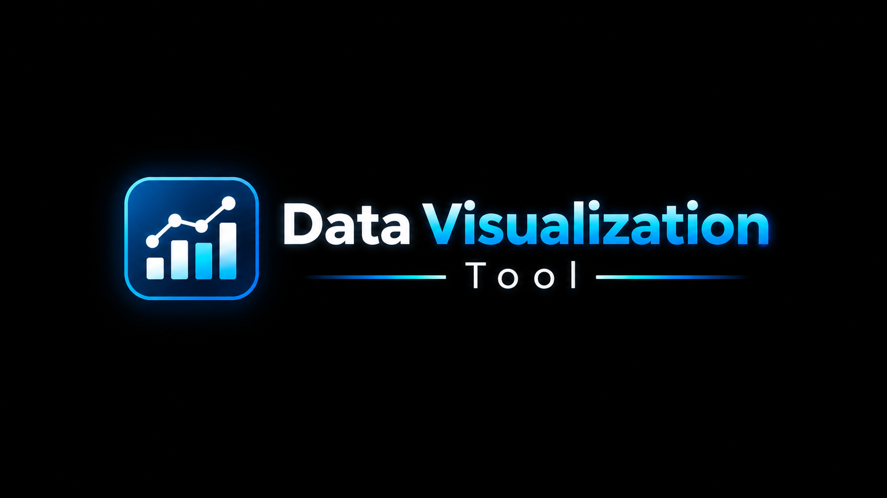

<!-- WELCOME: Always visible above the collapsible sections. -->

<!-- GitHub strips CSS background styles, so use a hosted gradient SVG banner for reliable rendering. -->

<!-- Five rotating welcome messages replace the previous static headline. -->

Custom software, intelligent applications, and practical developer tools — built to solve real-world problems.

<h3>Follow PandaDev &amp; Stay Connected</h3>

<!-- Compact icon-only official brand SVGs. No empty Shields.io badge labels (which produce 404s). -->

<!-- LinkedIn icon shown without a link until the correct profile URL is supplied. -->

---

<!-- GitHub profile README. Section titles are centered outside collapsible panels. The original expanded/collapsed defaults are preserved; add or remove `open` on a 
 tag to change its default state. -->

<!-- SECTION 1: Remove `open` from the 
 tag to collapse this section by default. -->
<h2 align="center">PandaDev // Development Studio</h2>

Show / Hide PandaDev

**CUSTOM WEB APPLICATIONS & SOFTWARE DEVELOPMENT**

---

<!-- SECTION 2: Remove `open` from the 
 tag to collapse this section by default. -->
<h2 align="center">Featured Applications // Showcase</h2>

Show / Hide Featured Applications

<!-- Two-column GitHub-compatible application showcase. -->
<table>
<tbody>

<tr>
<td align="center" valign="top"></td>
<td align="center" valign="top"></td>
</tr>
<tr>
<td align="center" valign="top"><h3 align="center">VulnHawk</h3>Web security scanning, repository audits &amp; monitoring</td>
<td align="center" valign="top"><h3 align="center">GameHubJS</h3>Free browser games &amp; community features</td>
</tr>
<tr>
<td width="50%" align="center" valign="middle"></td>
<td width="50%" align="center" valign="middle"></td>
</tr>
<tr>
<td valign="top"><strong>Highlights &amp; Tech Stack</strong>  • 83 security checks; OWASP Top 10:2025 • GitHub audits, scan comparisons &amp; compliance mapping • Seven report formats, scheduled scans &amp; SSL/uptime alerts • MFA, PWA &amp; worker monitoring  <strong>Stack:</strong> Python, FastAPI, SQLAlchemy, PostgreSQL, SQLite, Jinja2, Tailwind, APScheduler, Stripe, Resend, Render</td>
<td valign="top"><strong>Highlights &amp; Tech Stack</strong>  • 60+ browser games with leaderboards &amp; achievements • Google OAuth, 2FA, chat &amp; tournaments • Favorites, administration &amp; donations • Six languages, RTL &amp; PWA  <strong>Stack:</strong> Python, Flask, Jinja2, SQLAlchemy, PostgreSQL, SQLite, SocketIO, Redis, Canvas, Three.js, Stripe, Resend</td>
</tr>
</tbody>
</table>

---

<!-- SECTION 3: Remove `open` from the 
 tag to collapse this section by default. -->
<h2 align="center">Featured Tools // Utilities</h2>

Show / Hide Featured Tools

<!-- Three columns; dedicated button rows ensure horizontal alignment on GitHub. -->
<table>
<tbody>
<tr>
<td width="33%" align="center" valign="top"></td>
<td width="33%" align="center" valign="top"></td>
<td width="33%" align="center" valign="top"></td>
</tr>
<tr>
<td width="33%" align="center" valign="top"><h3 align="center">SchemaCraft</h3>Design relational databases visually with editable tables, columns, relationships, and indexes. Generate PostgreSQL, MySQL, or SQLite SQL; compare schema versions, review migration scripts, and save projects locally.</td>
<td width="33%" align="center" valign="top"><h3 align="center">Dev Tools</h3>A private developer workbench with 63 utilities across 11 categories. Format JSON and YAML, test regex, inspect URLs, generate code, compare text, and chain transformations—processed locally with offline support.</td>
<td width="33%" align="center" valign="top"><h3 align="center">Terminal Studio</h3>Practice Linux commands safely in a simulated terminal with 40+ commands, a virtual filesystem, guided lessons, challenges, and command previews. Explore files, save checkpoints, and learn without running real system commands.</td>
</tr>
<tr>
<td width="33%" align="center" valign="bottom"></td>
<td width="33%" align="center" valign="bottom"></td>
<td width="33%" align="center" valign="bottom"></td>
</tr>
<tr>
<td width="33%" align="center" valign="top"></td>
<td width="33%" align="center" valign="top"></td>
<td width="33%" align="center" valign="top"></td>
</tr>
<tr>
<td width="33%" align="center" valign="top"><h3 align="center">Python Academy</h3>Learn Python through structured lessons, knowledge checks, hands-on exercises, and projects. A persistent browser-based Python IDE lets you write and run practice code alongside the learning material.</td>
<td width="33%" align="center" valign="top"><h3 align="center">PDF Toolkit</h3>A free, privacy-focused PDF workspace with 14 tools to merge, split, reorder, convert, compress, watermark, and compare documents. Preview results before downloading; files are processed locally in your browser.</td>
<td width="33%" align="center" valign="top"><h3 align="center">Data Visualization Tool</h3>Turn CSV and Excel spreadsheets into interactive dashboards with seven chart types, searchable tables, filters, and data-quality insights. Export charts and reports while keeping spreadsheet data in your browser.</td>
</tr>
<tr>
<td width="33%" align="center" valign="bottom"></td>
<td width="33%" align="center" valign="bottom"></td>
<td width="33%" align="center" valign="bottom"></td>
</tr>
</tbody>
</table>

---

<!-- SECTION 4: Remove `open` from the 
 tag to collapse this section by default. -->
<h2 align="center">Toolbox // Stack</h2>

Show / Hide Toolbox

<h3 align="center">💻 Languages</h3>

       

    

<h3 align="center">🎨 Frontend & Development Tools</h3>

       

       

<h3 align="center">🗄️ Backend & Databases</h3>

       

       

<h3 align="center">☁️ Cloud, Mobile & Infrastructure</h3>

       

       

<h3 align="center">🤖 AI, Data & Other Tools</h3>

       

    

---

<!-- SECTION 5: Remove `open` from the 
 tag to collapse this section by default. -->
<h2 align="center">GitHub // Activity & Consistency</h2>

Show / Hide GitHub

  

  

