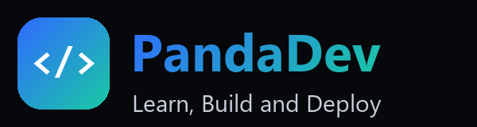
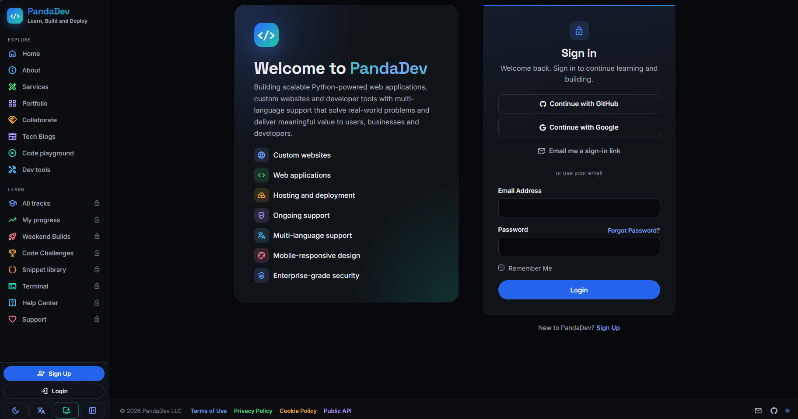

**CUSTOM WEB APPLICATIONS & SOFTWARE DEVELOPMENT**

<h2 align="center">PandaDev <code>// Development Agency</code></h2>

**Highlights**
- Custom websites and web applications tailored to individual and business needs.
- End-to-end development, from planning and user interface design to deployment.
- Business software solutions focused on usability, maintainability and growth.
- Responsive, accessible experiences for desktop, tablet and mobile.
- Multilingual website and application support.
- [Explore services and get in touch](https://www.pandadevhub.com/).

---

<h2 align="center">Featured Applications</h2>

<!-- GitHub-safe compact comparison: no nested tables or fixed pixel widths. -->
<table>
<thead><tr><th width="50%" align="center">🛡️ VulnHawk</th><th width="50%" align="center">🎮 GameHubJS</th></tr></thead>
<tbody>
<tr>
<td align="center" valign="top"></td>
<td align="center" valign="top"></td>
</tr>
<tr>
<td align="center" valign="top"></td>
<td align="center" valign="top"></td>
</tr>
<tr>
<td align="center" valign="top"><strong>Web security scanning, repository audits &amp; monitoring</strong> <a href="https://vulnhawk.app">Launch VulnHawk ↗</a></td>
<td align="center" valign="top"><strong>60+ free browser games &amp; community features</strong> <a href="https://www.gamehubjs.com/">Play GameHubJS ↗</a></td>
</tr>
<tr><th align="center">Highlights</th><th align="center">Highlights</th></tr>
<tr>
<td valign="top">• 83 security checks; OWASP Top 10:2025 • Public GitHub repository audits • Scan diffing &amp; compliance mapping • Seven export formats • Scheduled scans, SSL &amp; uptime alerts • MFA, PWA &amp; worker monitoring</td>
<td valign="top">• 60+ free browser games • Accounts, Google OAuth &amp; 2FA • Leaderboards &amp; achievements • Chat, favorites &amp; tournaments • Admin tools &amp; donation monitoring • Six languages, RTL &amp; PWA</td>
</tr>
<tr><th align="center">Tech Stack</th><th align="center">Tech Stack</th></tr>
<tr>
<td valign="top"><strong>Backend:</strong> Python, FastAPI, uv <strong>Data:</strong> SQLAlchemy, PostgreSQL, SQLite, Alembic <strong>UI:</strong> Jinja2, Tailwind, Three.js <strong>Jobs:</strong> asyncio, APScheduler, httpx <strong>Reports:</strong> WeasyPrint, XLSX, SARIF <strong>Services:</strong> Stripe, Resend, Web Push <strong>Ops:</strong> Render, structlog, pytest</td>
<td valign="top"><strong>Backend:</strong> Python, Flask, Jinja2 <strong>Data:</strong> SQLAlchemy, PostgreSQL, SQLite, Alembic <strong>Auth:</strong> Flask-Login, Authlib, Flask-WTF <strong>Realtime:</strong> SocketIO, eventlet, Redis <strong>UI:</strong> HTML, CSS, JS, Canvas, Three.js <strong>Services:</strong> Stripe, Resend <strong>Ops:</strong> Gunicorn, Flask-Babel, PWA</td>
</tr>
</tbody>
</table>

---

<h2 align="center">🚀 Feature Projects</h2>

| Project | Focus |
|---|---|
| [VulnHawk](https://vulnhawk.app) | Web security scanner |
| [ClaretHub](https://clarethub.com) | Portfolio |
| [PandaDev](https://www.pandadevhub.com) | Development agency |
| [BerrieBoo](https://berrieboo.com) | E-commerce |
| [GameHub JS](https://gamehubjs.com) | Browser games |
| [Panda3DPrints](https://www.panda3dprints.com) | 3D printing |

---

<h2 align="center">⚡ Toolbox <code>// Stack</code></h2>

<h3 align="center">💻 Languages</h3>

       

    

<h3 align="center">🎨 Frontend & Development Tools</h3>

       

       

<h3 align="center">🗄️ Backend & Databases</h3>

       

       

<h3 align="center">☁️ Cloud, Mobile & Infrastructure</h3>

       

       

<h3 align="center">🤖 AI, Data & Other Tools</h3>

       

    

---

<h2 align="center">📈 GitHub <code>// Activity & Consistency</code></h2>

  

 

  

