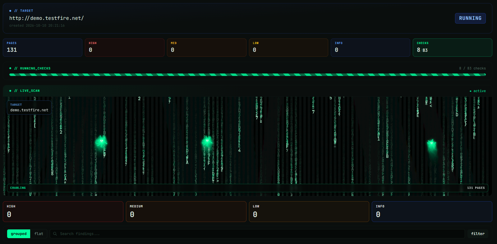
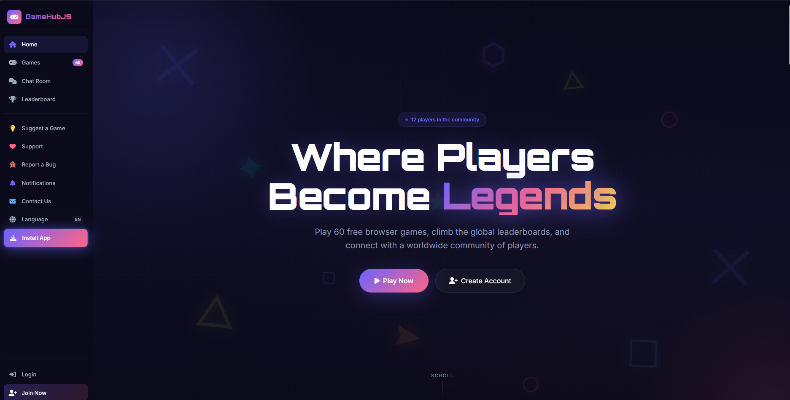
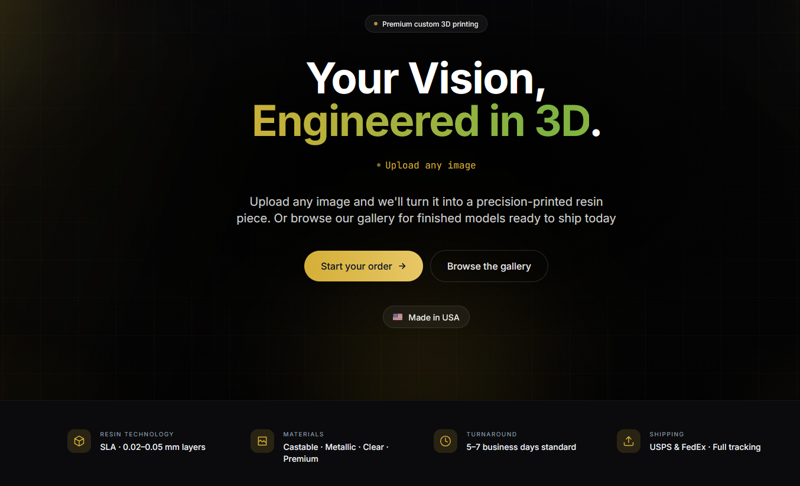
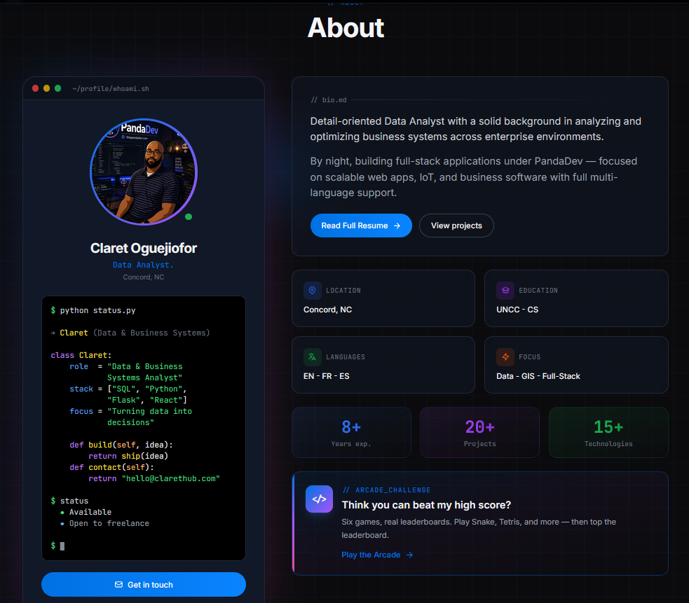

**WEB SECURITY AND VULNERABILITY SCANNER**

<strong>🎮 GameHubJS — 60+ Free Browser Games</strong>

<h3>Where Players Become Legends</h3>

Play 60+ free browser games, climb the global leaderboards, and connect with a worldwide community of players.

**Highlights**
- 60+ free browser games, with more games planned.
- Global leaderboards and player community features.
- Play instantly — no plugins or downloads.
- Full Responsive design - Works on desktop, tablet, and mobile.
- Always free — no ads or in-game purchases.

<strong>🐼 Panda3DPrints — Custom 3D Printing</strong>

<h3>Your Vision, Engineered in 3D.</h3>

Turn your images into precision-printed resin pieces, explore finished models, or browse custom creations from the gallery.

**Highlights**
- Upload an image or 3D file to start a custom order.
- Precision resin printing with castable, metallic, clear, and premium material options.
- Browse featured models and ready-to-ship gallery pieces.
- Standard custom-order turnaround of 5–7 business days, with tracking via USPS or FedEx.

<strong>🌐 ClaretHub — Personal Portfolio</strong>

<h3>My Personal Portfolio & Developer Hub</h3>

Explore my work, projects, and software development journey.

---

<h2 align="center">🧑‍💻 PandaDev <code>// Developer, Analyst & Security Engineer</code></h2>

  

<h3>Building secure web apps, scalable APIs, and practical software.</h3>

<em>Clean code. Scalable systems. Real-world impact.</em>

---

<h2 align="center">🛡️ VulnHawk <code>// Project Brief</code></h2>

  <h3>A web vulnerability scanner built from the ground up.</h3>
  

    Live dashboard · Categorized findings · Downloadable security reports
  

| Scanner | Details |
|---|---|
| Coverage | 83 checks · 10 categories |
| Framework | OWASP Top 10:2025 |
| Stack | Python · FastAPI · SQLAlchemy · PostgreSQL |
| UI & infrastructure | Jinja2 · Tailwind CSS · Three.js · Docker |
| Exports | PDF · XLSX · HTML · Markdown · CSV · JSON · SARIF |

<strong>Security features & pricing</strong>

- Password hashing, signed sessions, CSRF protections, SSRF defenses, and HMAC audit trails.
- **Free:** 5 scans/month across 4 categories.
- **Pro:** $29/month or $290/year.

[Open VulnHawk →](https://vulnhawk.app)

---

<h2 align="center">🚀 Feature Projects</h2>

| Project | Focus |
|---|---|
| [VulnHawk](https://vulnhawk.app) | Web security scanner |
| [ClaretHub](https://clarethub.com) | Portfolio |
| [PandaDev](https://www.thepandadev.com) | Development agency |
| [BerrieBoo](https://berrieboo.com) | E-commerce |
| [GameHub JS](https://gamehubjs.com) | Browser games |
| [Panda3DPrints](https://www.panda3dprints.com) | 3D printing |

---

<h2 align="center">⚡ Toolbox <code>// Stack</code></h2>

<strong>Languages</strong>

<strong>Frontend</strong>

<strong>Backend</strong>

<strong>Mobile, Desktop &amp; Cloud</strong>

<strong>AI &amp; Others</strong>

---

<h2 align="center">📈 GitHub <code>// Activity & Consistency</code></h2>

 

  

---

<h2>💚 Build boldly. Ship securely.</h2>

Developer • Analyst • Security Engineer

<strong>Explore my work</strong>

Building useful products across security, software, gaming, and 3D printing.

